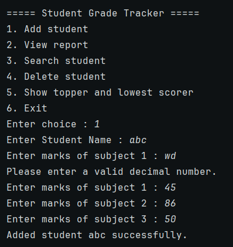
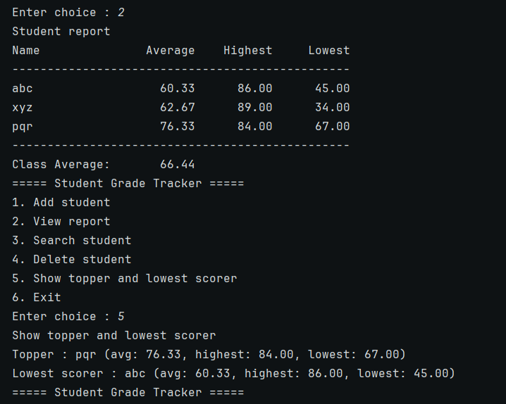
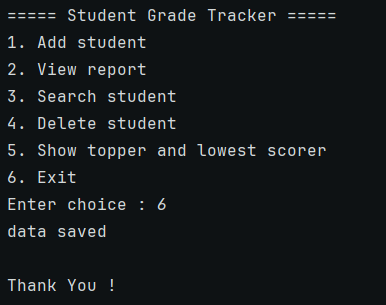
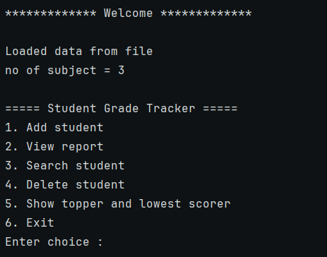

# 🎓 Student Grade Tracker

### A simple, menu-driven Java application to manage student performance.

> Developed as **Task 1** of the **CodeAlpha Java Programming Internship**.

Manage student records, calculate averages, identify toppers, and save student data between program runs, all from the command line.

<p align="center">
  
  
  
  
</p>

---

## 📌 About the Project

**Student Grade Tracker** is a console-based application developed in Java to simplify managing student marks and analyzing academic performance.

The project demonstrates core Java concepts such as object-oriented programming, collections, exception handling, input validation, and file handling.

The application lets users maintain multiple student records and preserve their data in a local file for future sessions.

## ✨ Features

- ➕ **Add Students:** Store student names and marks across multiple subjects.
- 📊 **Performance Analysis:** Calculate each student's average, highest mark, and lowest mark.
- 🔍 **Search Students:** Find student records using case-insensitive name matching.
- 🗑️ **Delete Students:** Remove an existing student record.
- 🏆 **Topper and Lowest Scorer:** Identify students based on their average marks.
- 📋 **Class Report:** Display a formatted table of student performance and the class average.
- 💾 **Persistent Storage:** Save student records to `students.txt` and load them on the next launch.
- ✅ **Input Validation:** Reject invalid numbers, out-of-range marks, blank names, and duplicate names.
- 🔄 **Interactive Menu:** Navigate through the available operations using a simple console menu.

## 🛠️ Technologies Used

| Technology | Purpose |
|---|---|
| Java 21+ | Core programming language |
| ArrayList | Store marks and student objects |
| OOP | Organize the application into separate classes |
| Java NIO (`Files`, `Path`) | Read and write student records |
| Exception Handling | Handle invalid input and file errors |
| String Formatting | Generate readable tabular reports |

## 🧠 Concepts Practiced

This project helped me apply the following concepts in a practical application:

- **Encapsulation:** Keep student fields private and expose appropriate methods.
- **Constructors:** Initialize student objects with names and marks.
- **Collections Framework:** Manage student records using `ArrayList`.
- **Input Validation:** Handle invalid user input using loops and exception handling.
- **File Handling:** Save and load student data using Java NIO.
- **Object Representation:** Override `toString()` to display student information clearly.
- **Formatted Output:** Use `printf()` and `String.format()` to display reports.

## 📂 Project Structure

```text
CodeAlpha_StudentGradeTracker/
├── screenshots/           # Console screenshots used in this README
├── src/
│   ├── Main.java          # Menu, input handling and user interaction
│   ├── Student.java       # Student data and marks calculations
│   └── GradeManager.java  # Student management, reports and file storage
├── .gitignore
└── README.md
```

*Note: `students.txt` is created when the application saves data. It is not part of the repository, so it won't exist in a fresh clone.*

## 🚀 Getting Started

### Prerequisites

- Java Development Kit (JDK) 21 or newer.
- A terminal or command prompt.
- Git, if you want to clone the repository.

Verify your Java installation:

```bash
java -version
javac -version
```

### Installation

**1. Clone the repository**

```bash
git clone https://github.com/Vanshika-gupta1/CodeAlpha_StudentGradeTracker.git
```

**2. Navigate to the source folder**

```bash
cd CodeAlpha_StudentGradeTracker/src
```

**3. Compile**

```bash
javac Main.java Student.java GradeManager.java
```

**4. Run**

```bash
java Main
```

Or open the project in IntelliJ IDEA and run `Main.java`.

## 💻 Application Menu

The application provides the following options:

```text
===== Student Grade Tracker =====
1. Add student
2. View report
3. Search student
4. Delete student
5. Show topper and lowest scorer
6. Exit
Enter choice :
```

Choose an option, follow the prompts, and manage your student records.

## 📸 Screenshots

### Adding a student (with input validation)
Invalid marks are rejected and the user is asked again.



### Class report, topper and lowest scorer
A formatted table with each student's average, highest and lowest marks, plus the class average.



### Saving data on exit
Student records are written to `students.txt` when the user exits.



### Data loaded on the next run
On the next launch the saved records are loaded automatically, so the number of subjects is not asked again.



## 💾 How Data Persistence Works

The application stores student information in a local text file named `students.txt`.

- The first line stores the number of subjects.
- Each following line stores a student's name followed by their marks, separated by commas.
- On startup, the program loads the existing records if the file exists.
- Data is saved when you choose **Exit (6)**. Closing the window without exiting will lose that session's changes.
- Saving writes to a temporary file first and then replaces the data file, so a failed save does not corrupt the existing data.

This keeps student data available after the program closes, without requiring a database.

**Important:** Keep the text-file format unchanged if editing the data manually. Student names containing commas are rejected to preserve the file format.

## 🔮 Future Improvements

- [ ] Add a graphical user interface using Java Swing or JavaFX.
- [ ] Store student records in MySQL using JDBC.
- [ ] Generate letter grades based on configurable grading criteria.
- [ ] Add sorting and filtering options.
- [ ] Support updating existing student records.
- [ ] Introduce automated unit tests.
- [ ] Improve file recovery and validation for corrupted records.

## 🎯 Project Goal

The goal of this project was to strengthen my Java programming skills by building a complete, interactive application that combines object-oriented programming, collections, input validation, and file handling.

## 👨‍💻 Author

**Vanshika Gupta**

Computer Engineering Student | Java Developer in Progress

- GitHub: [Vanshika-gupta1](https://github.com/Vanshika-gupta1)
- LinkedIn: [Vanshika Gupta](https://www.linkedin.com/in/vanshika-gupta-84845937a/)

---

⭐ If you find this project useful, feel free to explore the code and share your feedback.

---